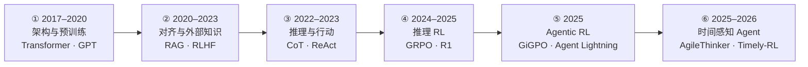
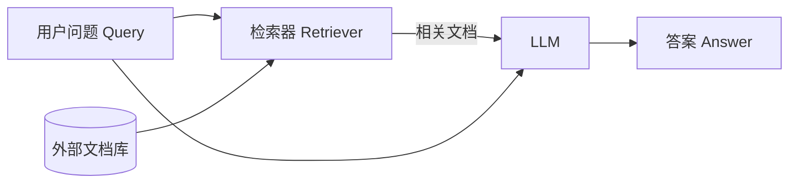

# 从 Transformer 到 Agentic RL：大模型发展脉络

主线：**架构 → 预训练范式 → 对齐与外部知识 → 推理与行动 → 用 RL 训练推理 → 用 RL 训练多轮 Agent → 让 Agent 适应真实时间**。
注意：很多方向是并行发展的，后一个不是完全取代前一个；年份按论文首次公开（多为 arXiv）计。

##### 0. 一张总表
| 阶段 | 时间 | 关键问题 | 代表工作 |
|---|---|---|---|
| ① 架构与预训练 | 2017–2020 | 模型怎么学会语言和知识？ | Transformer、GPT-1/2/3、Scaling Laws |
| ② 对齐与外部知识 | 2020–2023 | 怎么让模型听指令、少瞎编？ | RAG、Instruction Tuning、RLHF、DPO |
| ③ 推理与行动 | 2022–2023 | 怎么从"回答"走向"思考+行动"？ | CoT、ReAct、Toolformer、Reflexion |
| ④ 推理 RL | 2024–2025 | 怎么用 RL 把推理能力训出来？ | GRPO、o1、RLVR、DeepSeek-R1 |
| ⑤ Agentic RL | 2025 | 怎么用 RL 训练多轮交互的决策？ | Search-R1、RAGEN、GiGPO、Agent Lightning |
| ⑥ 时间感知 Agent | 2025–2026 | 怎么在时间耗尽或环境变化前做对？ | Real-Time Reasoning、Timely Machine |

##### 1. 架构与预训练范式（2017–2020）
| 年份 | 代表工作 | 关键洞察 |
|---|---|---|
| 2017 | Attention Is All You Need（Transformer） | 用 Self-Attention 取代 RNN，可并行训练、易于扩展 |
| 2018 | GPT-1 | Decoder-only 自回归预训练 + 下游任务微调 |
| 2018 | BERT | 同年的另一条路线：Encoder 双向预训练，擅长理解类任务 |
| 2019 | GPT-2 | 扩大规模后出现 Zero-Shot 迁移，不微调也能做任务 |
| 2020 | Scaling Laws（Kaplan 等） | Loss 随参数量、数据量、算力呈幂律下降，"做大"有据可依 |
| 2020 | GPT-3 | In-Context Learning：在 Prompt 里给例子就能做新任务 |

训练目标始终是预测下一个 Token：
$$
\mathcal L_{\mathrm{pretrain}}=-\sum_t\log P_\theta(x_t\mid x_{<t})
$$
- GPT-1 还是"预训练 + 每个任务单独微调"；到 GPT-3 变成"一个大模型 + Prompt 解决多种任务"。
- 2022 年 Chinchilla 修正了 Scaling Laws：同样算力下，数据量应与参数量同比例增长。
**这一阶段确立的范式：**
$$
\boxed{\text{Transformer}+\text{Next-Token Prediction}+\text{Scaling}}
$$
##### 2. 对齐与外部知识（2020–2023）
预训练模型会续写，但不一定听指令，也会编造事实。这一阶段有两条并行路线。
**路线 A：RAG（2020）——解决知识来源**
代表论文：Retrieval-Augmented Generation for Knowledge-Intensive NLP Tasks（同年还有 REALM）。

让模型使用检索到的外部文档，而不只依赖参数里存的知识。
**路线 B：指令微调与 RLHF（2021–2023）——解决听指令与对齐**

| 年份 | 代表工作 | 关键洞察 |
|---|---|---|
| 2017 | PPO；Deep RL from Human Preferences | 后来 RLHF 用到的 RL 算法和"从人类偏好学奖励"的思想 |
| 2021 | FLAN（Instruction Tuning） | 用大量指令格式的任务微调，模型能泛化到没见过的指令 |
| 2021 | WebGPT | 用 RLHF 训练模型浏览网页、引用来源，是 RAG + RL + 工具使用的早期结合 |
| 2022 | InstructGPT | 确立 SFT → Reward Model → PPO 的经典后训练流程 |
| 2022 | ChatGPT | 这套流程的产品化，让对话式大模型普及 |
| 2023 | DPO | 不训练 Reward Model、不跑 PPO，直接用偏好对优化策略 |

InstructGPT 的三步流程：① 人工示范数据做 SFT；② 人工对多个回答排序，训练 Reward Model；③ 用 Reward Model 打分，PPO 更新策略。
RLHF 的优化目标（奖励最大化 + 不偏离参考模型太远）：
$$
\boxed{
\max_\theta\ \mathbb E_{y\sim\pi_\theta(\cdot\mid x)}\big[r_\phi(x,y)\big]
-\beta D_{\mathrm{KL}}\big(\pi_\theta\,\|\,\pi_{\mathrm{ref}}\big)
}
$$
- $r_\phi$：从人类偏好数据学到的 Reward Model。
- $\pi_{\mathrm{ref}}$：SFT 后的参考模型。
**时间纠正：RAG（2020）早于 InstructGPT（2022）。两者解决不同问题，不是"先 SFT+RL、再 RAG"的继承关系。**
##### 3. 从 LLM 到 Agent：推理与行动（2022–2023）
| 年份 | 代表工作 | 关键洞察 |
|---|---|---|
| 2022 | Chain-of-Thought Prompting | 让模型先写中间推理步骤再给答案，复杂推理明显变好 |
| 2022 | ReAct | 把推理、行动、环境反馈放进同一个循环 |
| 2023 | Toolformer | 模型自己学会何时调用工具、调用哪个、传什么参数 |
| 2023 | Reflexion / Voyager | 利用失败反馈、反思记忆和技能库完成更长的任务 |
| 2023 | Let's Verify Step by Step（PRM） | 对推理的每一步打分（过程奖励），而不只看最终答案 |

ReAct 循环：
$$
\text{Thought}\rightarrow\text{Action}\rightarrow\text{Observation}\rightarrow\text{Thought}\rightarrow\cdots
$$

ReAct 论文图 1：同一个问题，(1a) 直接回答、(1b) 只推理（CoT）、(1c) 只行动都答错；(1d) ReAct 边想边搜索，根据 Observation 修正思路后答对。下半部分是 ALFWorld 家务任务中的同样对比。
- 这一阶段的 Agent 主要靠 **Prompt 工程**驱动，模型权重本身不因交互而更新。
- Reflexion 名字里有 "Reinforcement Learning"，但它是用语言反馈和记忆改进，不是梯度式 RL。
**这一阶段的变化：**
$$
\boxed{\text{LLM：回答问题}\ \longrightarrow\ \text{Agent：观察、思考、行动、反馈}}
$$
##### 4. 用 RL 训练推理能力（2024–2025）
| 时间 | 代表工作 | 核心突破 |
|---|---|---|
| 2024.02 | DeepSeekMath | 提出 GRPO：用组内相对奖励代替 Critic，省显存、易扩展 |
| 2024.09 | OpenAI o1 | 展示 RL 训练出的长推理，以及测试时多思考带来的收益 |
| 2024.11 | Tülu 3 | 提出 RLVR（Reinforcement Learning with Verifiable Rewards）这一叫法 |
| 2025.01 | DeepSeek-R1 | 公开展示：仅用规则可验证奖励做 RL，就能出现自我检查、反思等长推理行为 |

DeepSeekMath 图：PPO 需要额外训练一个 Value Model 并用 GAE 算优势；GRPO 对同一问题采样一组回答 $o_1\ldots o_G$，用组内奖励的相对高低直接得到优势，省掉 Value Model。
和 RLHF 的关键区别：**奖励不再来自学出来的 Reward Model，而是来自可以直接验证的规则**（数学答案对不对、代码测试过不过）。
**训练时改进（RLVR）：**
$$
\boxed{
\max_\theta\ \mathbb E_{y\sim\pi_\theta(\cdot\mid x)}\big[R_{\mathrm{verify}}(x,y)\big]
}
$$
**测试时改进（Test-Time Scaling）：**
$$
\boxed{\theta\ \text{固定},\quad C_{\mathrm{test}}\uparrow}
$$
不改权重，靠更长推理、多候选采样、搜索或验证投入更多测试时计算。两条路线互相促进：RL 训练出会"多想"的模型，测试时再给它更多思考预算。

DeepSeek-R1-Zero 训练曲线：只用可验证奖励做 RL，没有人教它"多想"，平均回答长度却从几百 Token 自发涨到一万多 Token，说明模型自己学会了用更长的推理换正确率。
**关键变化：从"让模型知道更多"走向"让模型推理得更好"。**
##### 5. Agentic RL：训练多轮决策（2025）
推理 RL 通常是单轮：
$$
\text{Question}\rightarrow\text{Reasoning}\rightarrow\text{Answer}\rightarrow R
$$
Agent 任务是多轮：
$$
h_0\xrightarrow{a_0}o_1\xrightarrow{a_1}o_2\cdots\xrightarrow{a_T}R
$$

| 时间      | 代表工作                                            | 解决的核心问题                              |
| ------- | ----------------------------------------------- | ------------------------------------ |
| 2025.03 | Search-R1                                       | 把搜索调用放进 RL 轨迹，训练模型边推理边检索             |
| 2025.04 | RAGEN                                           | 系统研究多轮 Agent RL 的不稳定性和训练设计           |
| 2025.05 | GiGPO                                           | 用锚点状态分组，把奖励分配到多轮轨迹中的具体步骤             |
| 2025.08 | Agent Lightning                                 | 解耦 Agent 执行与 RL 训练，让任意 Agent 框架接入 RL |
| 2025.10 | A Practitioner's Guide to Multi-turn Agentic RL | 环境、策略、奖励三方面的设计如何影响多轮 RL 效果           |

Search-R1 图：和上面 DeepSeekMath 的图对照看，唯一的结构变化是 Policy LLM 旁边多了 Search Engine——Rollout 不再是一次生成，而是"生成 ↔ 检索"多轮交替。这就是从推理 RL 走向 Agentic RL 的最小一步。

GiGPO 图（day 24 读过）：在多轮轨迹里找相同状态做步骤级分组，解决"奖励该分给哪一步"的问题。
这一阶段的两个核心难题：
- **Credit Assignment**：20 个动作后才知道成败，哪些动作该得正优势、哪些该得负优势？
- **Training-Agent Integration**：工具调用、环境反馈、动态工作流怎么变成 RL 能用的训练数据？
可以对照第 3 阶段理解：**ReAct 用 Prompt 让模型"会"交互；Agentic RL 用奖励把交互策略"训"进权重。**
##### 6. 时间感知与实时 Agent（2025–2026）
前面的工作大多默认：模型可以先想完再行动，思考是免费的。但真实系统里，**推理和工具调用都要花时间，环境也不会等**。

| 时间      | 代表工作                                                | 核心贡献                                                   |
| ------- | --------------------------------------------------- | ------------------------------------------------------ |
| 2025.11 | Real-Time Reasoning Agents in Evolving Environments | Token Clock 实时评测；AgileThinker 让快速反应与长期规划并行协作           |
| 2026.01 | Timely Machine                                      | 把测试时计算重新定义为真实耗时；Timely-Eval 评测；Timely-RL 训练模型按时间预算调整策略 |

AgileThinker 图（见下方论文笔记）：规划线程跨多步持续思考，反应线程每步按时出动作，并引用规划线程的中间结果。
问题的概念化表达（不是两篇论文的原始公式）：
$$
\boxed{
\max_\theta\ \mathbb E[R]
\quad\text{s.t.}\quad
T_{\mathrm{reasoning}}+T_{\mathrm{tools}}\leq T_{\max}
}
$$
**核心问题从"能不能完成任务"变成"能不能在环境变化或时间耗尽前完成任务"。**
##### 7. 怎么串起来
1. **2017–2020**：Transformer + 自回归预训练 + 规模化，得到通用基础模型。
2. **2020–2023**：RAG 补外部知识，指令微调 + RLHF 让模型听话、对齐偏好。
3. **2022–2023**：CoT、ReAct、工具使用，模型开始"思考 + 行动"，但主要靠 Prompt。
4. **2024–2025**：GRPO + 可验证奖励，用 RL 把推理能力训进模型。
5. **2025**：RL 从单轮推理扩展到多轮 Agent 交互，重点是信用分配和训练框架。
6. **2025–2026**：进一步把时间纳入决策，研究实时和时间受限的 Agent。
建议优先打通的阅读主线：
$$
\text{ReAct}\rightarrow\text{DeepSeekMath（GRPO）}\rightarrow\text{DeepSeek-R1}\rightarrow\text{GiGPO / Agent Lightning}\rightarrow\text{Real-Time / Timely Machine}
$$
这条线解释了 Agent 如何从 Prompt 驱动的交互系统，发展到用 RL 优化多轮决策，再到考虑真实时间约束。
